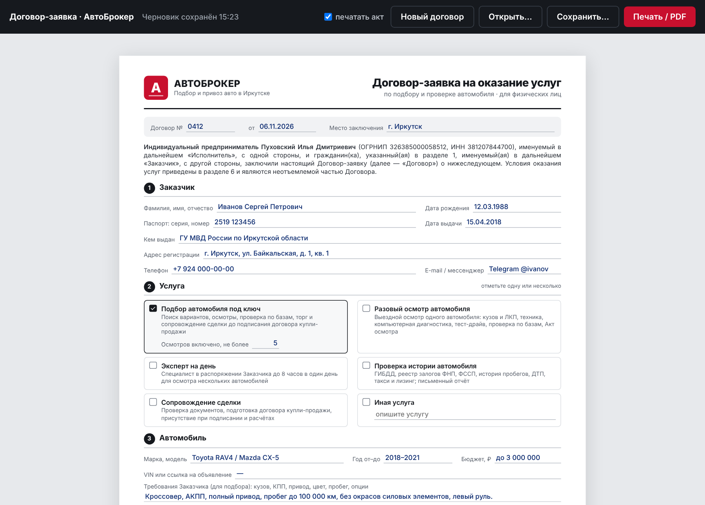
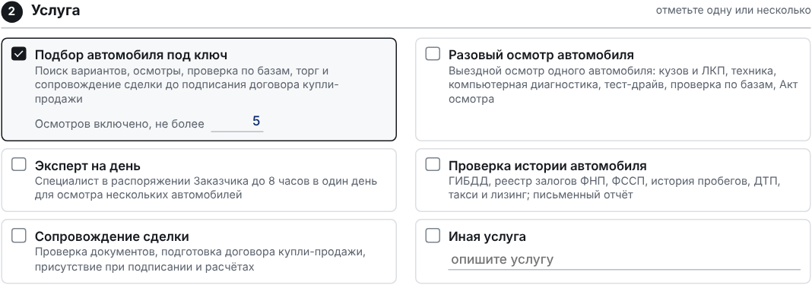
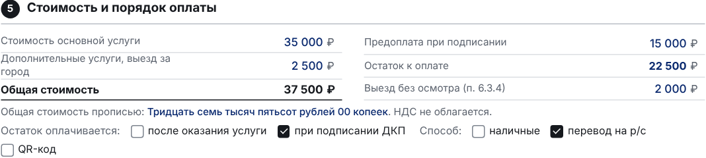
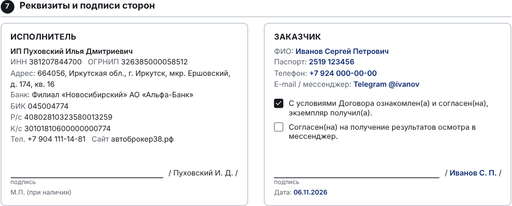
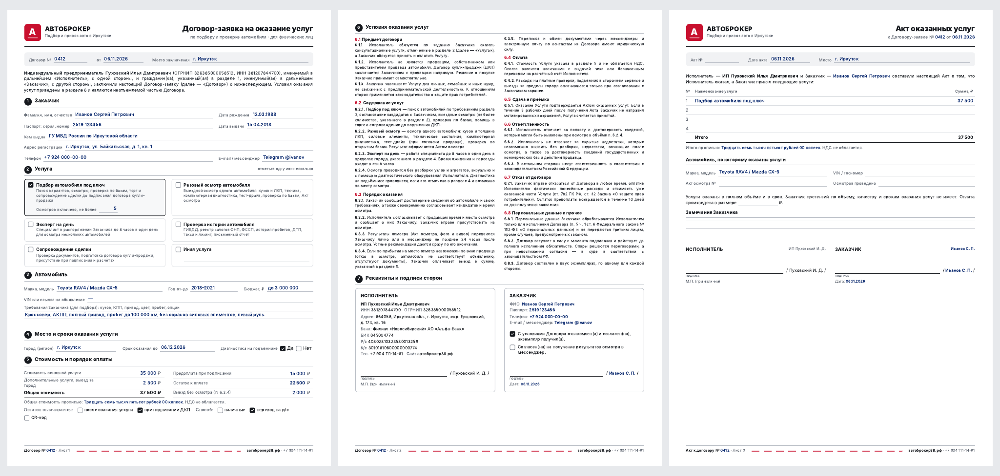

<div align="center">


# Договор-заявка на оказание услуг

**Программа для автоброкера: договор с клиентом и акт оказанных услуг, заполняется с клавиатуры, печатается на A4**

ИП Пуховский И. Д. · АвтоБрокер · Подбор и привоз авто в Иркутске · [автоброкер38.рф](https://автоброкер38.рф)

</div>

---



## Что это

Готовый договор с физическим лицом на подбор и проверку автомобиля. Все условия прописаны внутри документа, ссылаться на правила на сайте не нужно. Ваши реквизиты уже внесены, остаётся заполнить данные клиента, отметить услугу и вписать стоимость.

- **3 листа A4**: договор-заявка, условия оказания услуг с реквизитами и подписями, акт оказанных услуг
- **Сам считает**: общую стоимость, остаток после предоплаты, сумму прописью
- **Сам переносит** ФИО, паспорт, телефон и номер договора в подписи и в акт
- **Автосохранение черновика**, сохранение и открытие договоров файлами

---

## Быстрый старт

### Вариант 1. Сразу, без установки

Дважды кликните **`dogovor.html`**: договор откроется в браузере (Chrome, Edge, Яндекс) и уже готов к заполнению.

### Вариант 2. Отдельная программа `Dogovor.exe`

1. Нужен **Python 3.10 или новее** с [python.org](https://www.python.org/downloads/). При установке отметьте **Add python.exe to PATH**.
2. Дважды кликните **`build.bat`**: он сам установит пакеты и соберёт программу за 1–3 минуты.
3. Готовая программа: **`dist\Dogovor.exe`**. Её можно положить на рабочий стол, Python для запуска больше не нужен.

---

## Как заполнять

### Панель управления


| Кнопка | Что делает |
|---|---|
| **печатать акт** | Включает или выключает лист 3 (акт) при печати. Акт обычно подписывают позже, после оказания услуги |
| **Новый договор** | Очищает форму, ставит сегодняшнюю дату |
| **Открыть…** | Загружает сохранённый договор (`.json`) |
| **Сохранить…** | Сохраняет в файл с именем вида `Договор №0412 Иванов С. П. 06.11.2026.json` |
| **Печать / PDF** | Печать или сохранение в PDF |

### Услуги



Отметьте одну или несколько услуг: подбор под ключ (с лимитом осмотров), разовый осмотр, эксперт на день, проверка истории, сопровождение сделки или своя услуга.

### Стоимость



Введите стоимость основной услуги, дополнительных услуг и предоплату. **Общая стоимость, остаток и сумма прописью считаются сами.** Суммы форматируются при выходе из поля: `35000` превращается в `35 000`.

### Реквизиты и подписи



Реквизиты ИП внесены в договор заранее. Данные заказчика подставляются из раздела 1, а ФИО сокращается для подписи до вида «Иванов С. П.».

### Акт оказанных услуг

При нажатии **Печать / PDF** акт заполняется сам, если он ещё пустой: переносятся выбранные услуги, модель авто и сумма. Поля акта можно поправить вручную.

---

## Печать и PDF



| Настройка | Значение |
|---|---|
| Принтер | Ваш принтер или **Сохранить как PDF** |
| Формат | A4, книжная |
| Поля | Нет |
| Колонтитулы | Выключить |
| Фоновая графика | **Включить** |

Договор печатается в **двух экземплярах**: один клиенту, один себе.

---

## Где хранятся данные

| Что | Где |
|---|---|
| Сохранённые договоры (программа) | `Документы\Договоры\*.json` |
| Сохранённые договоры (браузер) | Папка «Загрузки» |
| Черновик (программа) | `%APPDATA%\AvtoBroker\Dogovor` |

В файлах договоров лежат паспортные данные клиентов. Не пересылайте их посторонним и храните в защищённой папке.

---

## Состав папки

```
Договор - программа/
├── dogovor.html   — сам договор (вёрстка, условия, расчёты, сохранение)
├── app.py         — программа-окно на pywebview
├── build.bat      — сборка Dogovor.exe одним кликом
├── icon.ico       — иконка
├── README.md      — это описание
└── screenshots/   — картинки для описания
```

## Как поменять текст договора или реквизиты

Откройте `dogovor.html` в PyCharm:

- **реквизиты ИП**: блок `ИСПОЛНИТЕЛЬ` в разделе 7 и преамбула в начале;
- **условия**: раздел 6, каждый пункт в отдельной строке `<p>`;
- **услуги**: раздел 2, блоки `<label class="svc">`;
- **телефон и сайт в подвале**: строки с `автоброкер38.рф` (встречаются 3 раза).

После правок пересоберите `.exe` через `build.bat`.

> Текст договора составлен как типовой шаблон и не является юридической консультацией. Перед использованием покажите его юристу.

---

<div align="center">

**АвтоБрокер** · ИП Пуховский Илья Дмитриевич
[автоброкер38.рф](https://автоброкер38.рф) · +7 904 111-14-81

</div>
